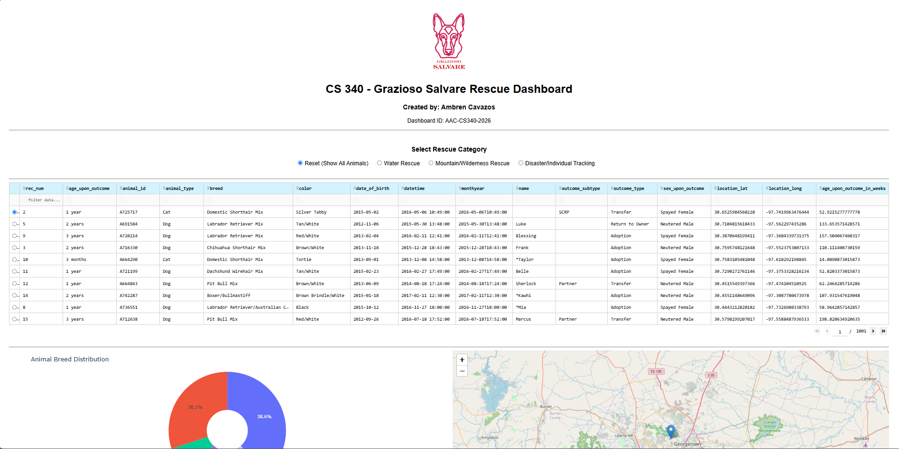
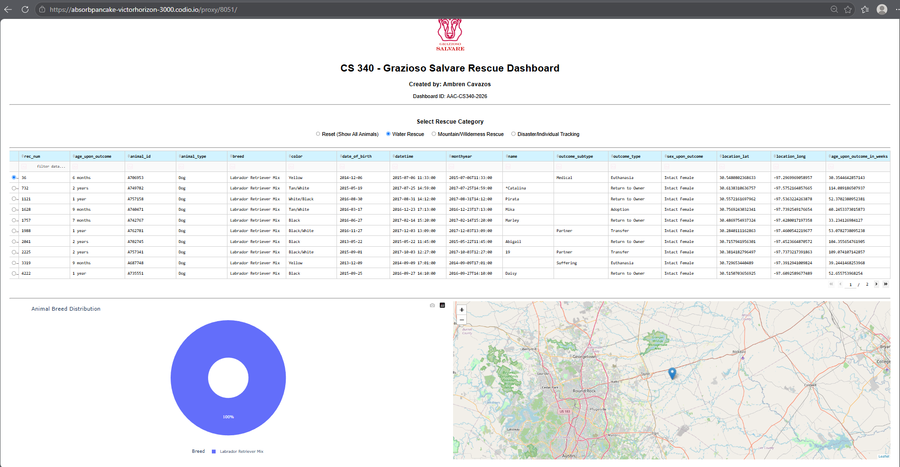
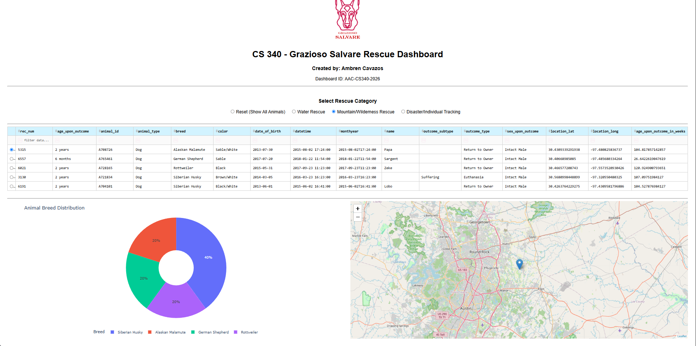
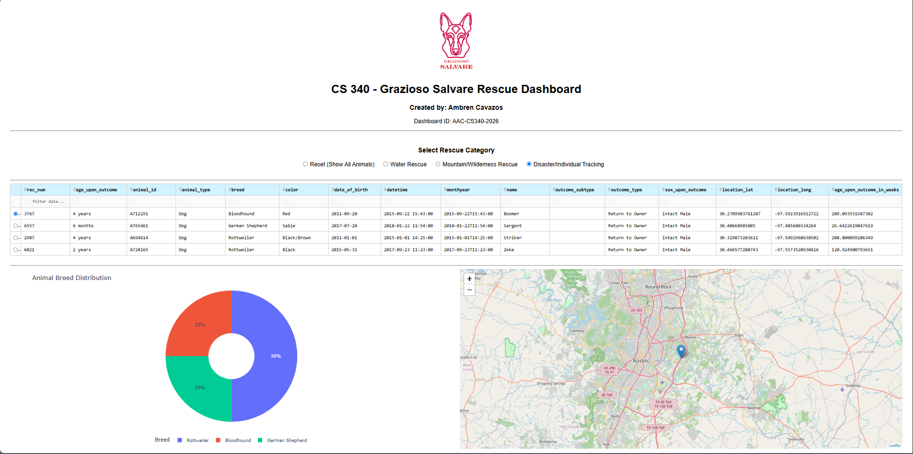
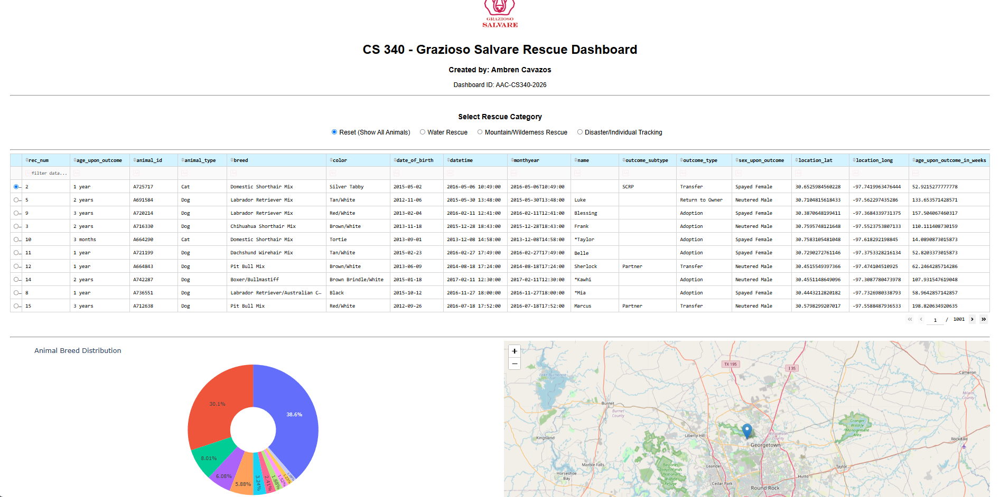

# Grazioso Salvare Rescue Dashboard

CS 340 Project Two by Ambren Cavazos. Dashboard identifier: `AAC-CS340-2026`.

This dashboard helps Grazioso Salvare identify shelter dogs that may be suitable for search-and-rescue training. MongoDB queries retrieve animal records, and a Python dashboard presents a filterable table, breed distribution chart, and animal location map.

## Features

- Water, mountain/wilderness, and disaster/individual tracking rescue filters.
- Reset retrieves all animal records.
- Interactive table with sorting, column filters, single-row selection, and ten records per page.
- Doughnut chart showing the ten most common breeds and grouping remaining breeds as Other Breeds.
- Dash Leaflet map showing the selected animal's available coordinates.
- Official logo linked to SNHU and creator identification.

## Project structure

```text
README.md
ProjectTwoDashboard.ipynb
CRUD_Python_Module.py          # AnimalShelter CRUD operations
Grazioso Salvare Logo.png
screenshots/
    01-initial-dashboard.png
    02-water-rescue.png
    03-mountain-wilderness.png
    04-disaster-tracking.png
    05-reset.png
```

Keep the notebook, CRUD module, and logo in the same directory. The logo filename must match the notebook exactly.

## Tools and setup

The notebook uses Python, MongoDB, PyMongo through the Project One module, Pandas, Dash, JupyterDash, Plotly Express, and Dash Leaflet. Use the compatible course Codio environment for this final project version.

1. Provide `CRUD_Python_Module.py` containing `AnimalShelter(username, password)` and `read(query)` returning animal documents.
2. Confirm the module's MongoDB connection settings. The project documentation identifies the `aac` database and `animals` collection; verify these against your course environment.
3. Place the official logo beside the notebook and confirm all imported libraries are installed.
4. Set `AAC_MONGO_PASSWORD` privately in the notebook process environment. The notebook uses username `aacuser` and raises an error if the password variable is absent. Do not write a real password in a notebook cell or commit it to Git.
5. Open `ProjectTwoDashboard.ipynb` and run the cells in order. The notebook configures the JupyterDash proxy and starts in external mode on port 8051. Open the generated Codio proxy link.

Internet access is needed for map tiles. JupyterDash compatibility depends on the course environment; this repository does not pin a verified standalone dependency set.

## Rescue query criteria

| Category | Breeds | Sex | Age in weeks |
| --- | --- | --- | --- |
| Water | Labrador Retriever Mix, Chesapeake Bay Retriever, Newfoundland | Intact Female | 26–156 |
| Mountain or wilderness | German Shepherd, Alaskan Malamute, Old English Sheepdog, Siberian Husky, Rottweiler | Intact Male | 26–156 |
| Disaster or individual tracking | Doberman Pinscher, German Shepherd, Golden Retriever, Bloodhound, Rottweiler | Intact Male | 20–300 |

Queries require `animal_type` to be Dog and use exact breed matching plus inclusive bounds on `age_upon_outcome_in_weeks`. These criteria match the supplied Dashboard Specifications Document. Check actual dataset labels if expected breeds do not appear.

## Screenshots

These screenshots were recovered from the supplied Google Doc. They show the course dashboard in use; they do not establish that the sanitized notebook has been rerun in this workspace.

### Initial dashboard



### Water rescue



### Mountain or wilderness rescue



### Disaster or individual tracking



### Reset



## Validation and limitations

The publication copy has passed Python syntax checks. Its embedded database password was replaced with an environment-variable lookup, and saved cell outputs and execution counts were cleared. No live database or Codio execution was performed in this workspace. The included CRUD module uses MongoDB on localhost:27017, the `aac` database, and the `animals` collection. Credentials are passed separately to the MongoDB client. Missing passwords are rejected. Constructor checks passed with a simulated client; a real database connection remains untested.

The current Reset callback reloads all records but does not explicitly clear table text filters or selection. Full reset behavior should be checked against the specification, which asks all widgets to return to their original unfiltered state. The map checks missing numeric coordinates, but does not validate geographic ranges.

## Credential safety

Never commit database passwords, credential-bearing connection strings, private environment files, or sensitive notebook outputs. Review the CRUD module and screenshots before publication. The included `.gitignore` excludes common environment files and notebook checkpoints; it cannot detect secrets embedded in source code.

## Responsible use of generative AI

The supplied project documentation states that generative AI assistance was used to review callback structure, troubleshoot application behavior, and improve code readability.
